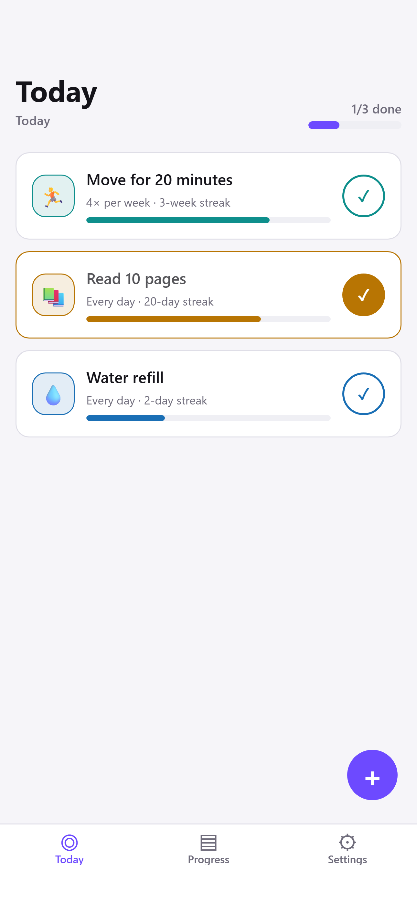
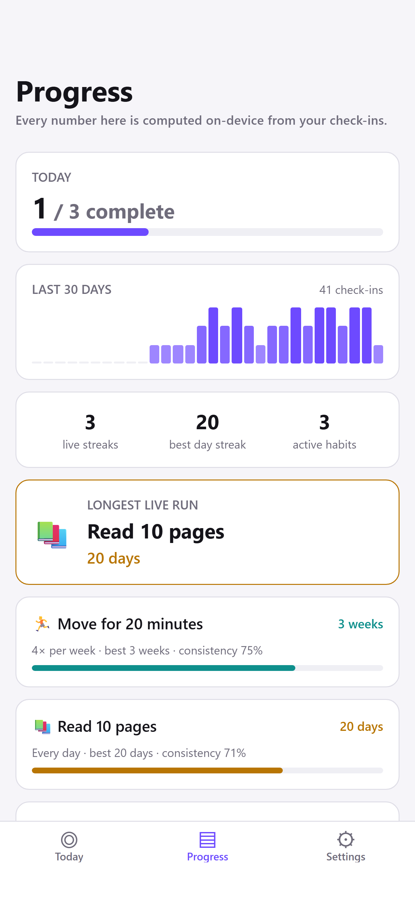
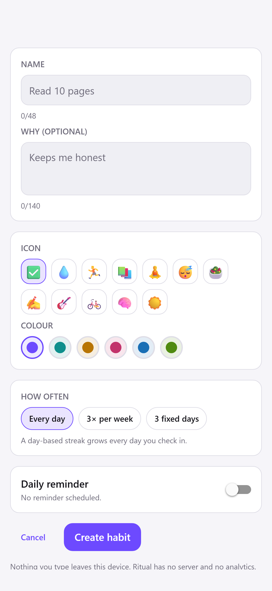
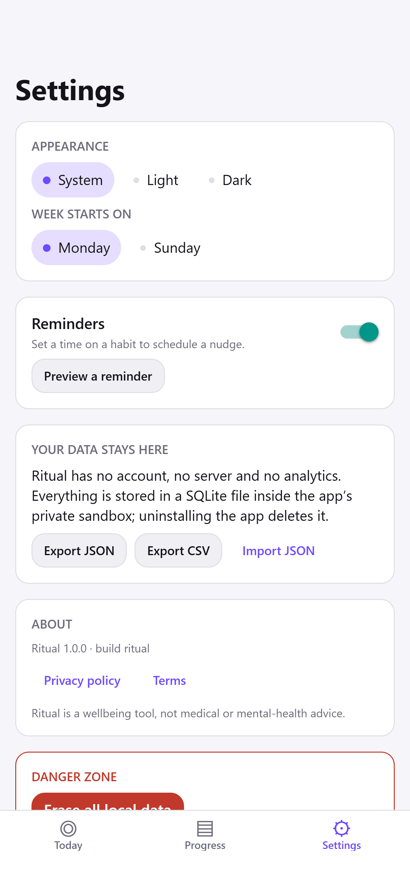

# Ritual

**An offline-first habit tracker with streaks.**

Ritual is a native iOS and Android app for keeping habits, built with Expo SDK 58, React Native 0.88 and TypeScript. It tracks daily, weekly-quota and fixed-day habits, computes streaks that survive an in-progress period, and shows consistency, a contribution-style heatmap and a weekday breakdown — all from a SQLite database inside the app's private sandbox. There is no backend, no account, no analytics and no network permission: nothing you log ever leaves your phone.

**License:** MIT · **Platforms:** iOS and Android (Expo SDK 58 / React Native 0.88) · **Network access:** none · **Language:** English and Spanish docs

- [Try it in 60 seconds](#try-it-in-60-seconds)
- [Why this exists](#why-this-exists)
- [Features](#features)
- [Architecture](#architecture)
- [Testing](#testing)
- [Scripts](#scripts)
- [Privacy model](#privacy-model)
- [Roadmap](#roadmap)
- [Decisions I'd defend in an interview](#decisions-id-defend-in-an-interview)

---

## Why this exists

Most habit apps are subscription-funded, which means their roadmap is "collect more data, send more notifications". I wanted the opposite: an app whose business model is nothing at all, so its only incentive is to be useful on the device in your hand.

That constraint drove every interesting engineering decision here. Without a server, the data model has to be sound locally: relational queries and migrations in SQLite, a streak engine that is pure and exhaustively testable, and a date model that cannot be broken by daylight-saving time or a changed time zone. Offline-first is not a marketing line in this repo — it is the reason the domain layer imports nothing from React Native.

Two product details matter more than they look, and both are implemented rather than described:

1. **Frequency-aware streaks.** A "3× per week" habit cannot be measured in consecutive days. Ritual measures it in consecutive _weeks_, so a streak of 6 means six weeks on target. See [ADR 0004](./docs/adr/0004-week-based-streaks-for-quota-habits.md).
2. **A grace rule.** Today — or the week you are still inside — being unchecked does not break a streak. A streak should only die when a period you could have satisfied went unsatisfied.

## Try it in 60 seconds

```bash
git clone https://github.com/Tserriednich-Git/ritual.git
cd ritual
npm install
npx expo start
```

Then scan the QR code with the Expo Go app on your phone (iOS) or with the Camera/QR flow on Android.

On first run the app seeds three starter habits — _Move for 20 minutes_, _Read 10 pages_, _Water refill_ — and deliberately **zero** check-ins, so no streak appears that you did not earn. Delete them in the editor if you want a blank slate.

Prerequisites: Node 22 (see [`.nvmrc`](./.nvmrc)) and npm.

> [!NOTE]
> **Notifications need a development build on Android.** Expo Go only ships its own bundled native modules, so scheduled reminders through `expo-notifications` will not behave there. Build a dev client instead:
>
> ```bash
> npm run prebuild
> npx expo run:android   # or: npx expo run:ios
> ```
>
> or `eas build --profile development --platform android`. Everything except reminders runs fine in Expo Go.

## Features

### User-facing

| Area             | What it does                                                                                                                                                                 |
| ---------------- | ---------------------------------------------------------------------------------------------------------------------------------------------------------------------------- |
| Habits           | Create, edit, archive, unarchive, delete, reorder (up to 24 active habits). Archiving is a soft delete (`archived_at`), so history still feeds the stats.                    |
| Frequency models | Every day · N times per week (a weekly quota, target 1–7) · specific weekdays.                                                                                               |
| First run        | Three starter habits are seeded with **no** check-ins, so no streak is fabricated.                                                                                           |
| Check-in         | One tap on the Today tab toggles today; a repeated tap is idempotent. Optional short note per day (140 characters).                                                          |
| Streaks          | Day-based for daily and fixed-day habits; **week-based** for weekly-quota habits. Longest streak is never lower than the current one.                                        |
| Grace rule       | An unchecked today, or an in-progress week, does not break the streak.                                                                                                       |
| Progress         | Consistency % over a trailing 28-day window, contribution-style heatmap, weekday breakdown over a trailing 12-week window, plus a per-habit detail screen with a week strip. |
| Reminders        | Local daily notification per habit at a chosen `HH:MM`, and a "Preview a reminder" action in Settings. Off unless you enable one.                                            |
| Appearance       | Light, dark or system theme; a Sunday/Monday week-start preference for the week strip.                                                                                       |
| Your data        | JSON and CSV export written into the app's own folder and handed to the OS preview/share sheet; JSON import with **merge** or **replace**.                                   |

### Engineering

- **Pure domain core.** `src/domain` holds types, civil-date helpers, frequency rules, the streak engine, stats, validation and the backup-file schema. It imports nothing from React Native, so the rules run in Node under Jest and could run unchanged on a server someday.
- **Versioned SQLite migrations.** Forward-only, each applied inside one transaction, tracked with `PRAGMA user_version`; `UNIQUE (habit_id, local_date)` and `CHECK` constraints live in the schema itself.
- **Typed navigation.** React Navigation with one typed contract (`TabsParamList`, `RootStackParamList`): bottom tabs (Today / Progress / Settings) plus a native stack for `HabitEditor` and `HabitDetail`.
- **Strict TypeScript.** `strict`, plus `noUncheckedIndexedAccess`, `noImplicitOverride` and `noFallthroughCasesInSwitch` — no ambient-any escape hatches.
- **Injected clocks.** Every date-sensitive function takes `today` as an optional parameter, so streak tests are deterministic without mocking `Date`.
- **Flat-config ESLint + Prettier**, `expo-doctor` in CI, and CI that runs lint, typecheck and tests with coverage on every push and pull request.
- **New Architecture** enabled, Hermes runtime. `react-native-web` and `react-dom` are there so the web target can bundle at all; nothing in `App.tsx` or `src/` imports them, and the product target stays iOS/Android.

## Architecture

Three rules hold the whole thing together:

1. Screens never talk to SQLite. They dispatch to the store and read derived selectors.
2. The repository is the only module allowed to touch `expo-sqlite`.
3. `src/domain` is pure TypeScript: no React, no React Native, no Expo imports. Everything below it may depend upward on domain types; nothing may depend downward on UI.

```mermaid
flowchart TD
    UI["src/features/&lt;feature&gt; (screens)<br/>src/app/navigation (React Navigation)"] --> STORE["src/store (zustand)<br/>actions + derived selectors"]
    STORE --> DB["src/db (expo-sqlite repository<br/>+ versioned migrations)"]
    STORE --> NOTIF["src/notifications<br/>(local reminder scheduling)"]
    UI --> THEME["src/theme"]
    DB --> DOMAIN["src/domain (pure TS)<br/>types · date · frequency · streak · stats · validation"]
    NOTIF --> DOMAIN
    STORE --> DOMAIN
    UI --> DOMAIN
    DOMAIN -.->|"no RN/Expo imports"| STOP[""]
```

Plain-text version, for terminals:

```text
  src/app/navigation      src/features/<feature>        src/theme
            |                       |                       |
            +-----------> src/store (zustand) <--------------+
                            |           |
              +-------------+           +--------------+
              |                                       |
      src/db (expo-sqlite)                   src/notifications
              |                                       |
              +-------------> src/domain <------------+
                     pure TS: types, date, frequency,
                     streak, stats, validation
                (imports nothing from React Native / Expo)
```

Data flows one way: repository rows are mapped to domain types, the store holds them, and every number on screen is _derived_ from those rows rather than stored. A check-in tap therefore does not "update a streak counter"; it inserts one completion and lets `computeStreak` re-derive the answer. That makes the visible number impossible to desynchronise from the data. Full detail in [`docs/ARCHITECTURE.md`](./docs/ARCHITECTURE.md).

## Testing

133 tests in 11 suites, all deterministic — no clock mocking, no network, no device. Run them with `npm test`.

Configuration as it stands in `jest.config.js` and `jest.setup.ts`:

- preset `jest-expo`; test match `**/__tests__/**/*.test.{ts,tsx}` (co-located folders);
- `jest.setup.ts` mocks `expo-notifications` and `expo-device`, because those native modules do not exist under Jest;
- coverage is collected from the pure logic that is actually asserted on: `src/domain/**`, `src/store/selectors.ts`, `src/db/mapping.ts`, `src/utils/id.ts` and `src/components/HabitRow.tsx`. Screens are excluded on purpose — they are verified on a device, and folding them into the report would only dilute it;
- threshold on that set: 90% statements, lines and functions, 80% branches. Measured today: **96.8% statements, 86.5% branches, 99.1% functions, 97.9% lines**.

What each suite pins down:

| Suite                 | Protects                                                                                                                                                                                           |
| --------------------- | -------------------------------------------------------------------------------------------------------------------------------------------------------------------------------------------------- |
| `domain/date`         | `YYYY-MM-DD` round-tripping, impossible dates like `2026-02-30`, day arithmetic across a DST boundary, Monday- and Sunday-based week starts, ISO week keys at a year boundary, the no-ICU fallback |
| `domain/frequency`    | which days are scheduled per model, and `expectedCompletions` over partial ranges — a weekly quota never owes more than one week's worth from a remainder                                          |
| `domain/streak`       | day vs week units, current vs longest, the grace rule for an unchecked today and an unfinished current week, gaps that genuinely break a run, the wording of the labels the UI prints              |
| `domain/stats`        | consistency over the trailing 28-day window, heatmap levels, weekday rates, a creation date in the future not wiping history                                                                       |
| `domain/validation`   | name and description limits, colour and icon tokens, weekly bounds 1–7, unique weekdays, `HH:MM` reminders, duplicate names                                                                        |
| `domain/backup`       | v1 `ritual.backup` round trip, rejection of malformed payloads, per-entry recovery, CSV quoting                                                                                                    |
| `db/mapping`          | row ↔ domain mapping, target clamping, a corrupt row degrading instead of throwing                                                                                                                 |
| `store/selectors`     | the Today list, progress summary and sparkline totals derived from a plain snapshot                                                                                                                |
| `components/HabitRow` | the two separate tap targets (open vs check-in) and the accessible labels that carry them, through `@testing-library/react-native`                                                                 |
| `utils/id`            | id shape, uniqueness over 5 000 draws, timestamp ordering                                                                                                                                          |

Screens (`features/**`) have no automated tests yet — the navigation tree and the SQLite/notifications integrations need a runtime. Everything they display comes from the selectors and domain functions above, which is where the assertions live.

```bash
npm test              # single run
npm run test:watch    # iterate on one file
npm run test:coverage # enforces the coverage threshold
```

## Scripts

| Script                  | Command                 | Use it to                                                         |
| ----------------------- | ----------------------- | ----------------------------------------------------------------- |
| `npm start`             | `expo start`            | start the dev server and QR code                                  |
| `npm run android`       | `expo start --android`  | attach to an Android device/emulator                              |
| `npm run ios`           | `expo start --ios`      | attach to an iOS simulator                                        |
| `npm run web`           | `expo start --web`      | Metro web build — possible, but the product target is iOS/Android |
| `npm run lint`          | `expo lint`             | lint with the flat Expo config                                    |
| `npm run typecheck`     | `tsc --noEmit`          | type-check without emitting                                       |
| `npm test`              | `jest`                  | run the test suite                                                |
| `npm run test:watch`    | `jest --watch`          | watch mode                                                        |
| `npm run test:coverage` | `jest --coverage`       | coverage against the configured threshold                         |
| `npm run format`        | `prettier --write …`    | format TS/JS/JSON/MD/YAML                                         |
| `npm run format:check`  | `prettier --check …`    | CI-safe format check                                              |
| `npm run check`         | lint → typecheck → test | the pre-commit gate                                               |
| `npm run doctor`        | `expo-doctor`           | diagnose dependency/config problems                               |
| `npm run prebuild`      | `expo prebuild`         | regenerate the `android/` and `ios/` projects                     |

## Privacy model

This is the headline, so it is stated plainly:

- **No backend.** There is no server in this project to run, deploy or compromise.
- **No accounts, no sign-in, no third-party auth.**
- **No analytics, no ads, no crash reporting, no tracking SDKs.** Nothing is sent anywhere, not even diagnostics.
- **No network permission is used by app code**, and the runtime dependencies listed in `package.json` are all open-source Expo/React Native modules that perform no reporting of their own. The only outbound action in the app is opening the hosted privacy-policy and terms links in Settings through the operating system's browser — the app itself never fetches or posts anything.
- **All user data is a SQLite file in the app's private sandbox.** Deleting the app deletes the data. OS-level device backup (iCloud / Google One) may carry that sandbox — see [the privacy policy](./legal/PRIVACY_POLICY.md) and [the threat model](./SECURITY.md).
- **Notifications are 100% local.** Reminders use `expo-notifications` scheduled triggers on the device: no push, no FCM or APNs registration tokens, no remote payload, no notification service extension.
- **Export and import are the data-portability path.** CSV and JSON out, JSON in, on the device.

Store-facing declarations are documented in [`legal/DATA_SAFETY.md`](./legal/DATA_SAFETY.md); `app.json` already sets `ITSAppUsesNonExemptEncryption: false` for iOS.

## Roadmap

Deliberately small, and in no particular order:

- Widget / live-activity surface for today's remaining habits.
- Make the stored week-start preference (Sunday/Monday) drive streak period keys as well as the week strip; today only the strip follows it, while weekly streaks use Monday-based ISO weeks.
- Screen-level tests inside a test navigator, so the flows (create → check in → archive → restore from backup) are covered, not only the derivations.
- Monthly and yearly summary views on top of the existing stats.
- Habit templates for common goals.
- Localisation beyond English, using the locale-aware formatting hooks already in the date helpers.
- Optional encrypted export file (passphrase-derived key) for users who route backups through cloud storage.
- Accessibility pass: screen-reader labels per heatmap cell and a reduce-motion path.

## Decisions I'd defend in an interview

- **Week-based streaks for quota habits, with a grace rule.** Naive day-consecutive streaks punish a 3×-per-week habit for existing on Wednesday. [ADR 0004](./docs/adr/0004-week-based-streaks-for-quota-habits.md).
- **Civil dates (`YYYY-MM-DD`) instead of UTC instants.** A habit completion is a calendar day, not a millisecond. Storing instants makes DST and travel shift completions into the wrong day; integer day arithmetic on UTC-derived day numbers sidesteps both.
- **SQLite over key-value storage.** Streaks and consistency are range queries over dates, and one row per check-in wants a uniqueness constraint. [ADR 0002](./docs/adr/0002-expo-sqlite-over-async-storage-or-watermelondb.md).
- **No backend, accepted as a permanent product stance.** [ADR 0001](./docs/adr/0001-offline-first-no-backend.md) — including the costs: no sync, no cross-device continuity, backups are the user's problem.
- **React Navigation instead of Expo Router** for this build. [ADR 0003](./docs/adr/0003-react-navigation-over-expo-router.md) — Expo Router is the default recommendation; this is a deliberate trade for explicit, easily testable navigation state.
- **Derived state over stored counters.** Storing a streak number invites it to drift from the completions table; recomputing it from rows cannot drift.
- **The domain layer has zero framework imports.** That is what makes a 90% coverage floor on the streak engine realistic.

## Screenshots

| Today                                                                       | Progress                                                                          | Habit editor                                                                 | Settings                                                                          |
| --------------------------------------------------------------------------- | --------------------------------------------------------------------------------- | ---------------------------------------------------------------------------- | --------------------------------------------------------------------------------- |
|  |  |  |  |
| <!--  -->            | <!--  -->            | <!--  -->           | <!--  -->            |

These are the real screens — the same component tree, reducer-free store, SQLite
schema and seed the app ships — rendered through the React Native web target at
iPhone 16 Pro metrics (1290 × 2796) and captured headlessly. Two consequences to
read them with: the numbers come from a demo fixture of three habits and ~60
check-ins, which a fresh install does not have, and there is no OS status bar
because a browser cannot draw one. Store submissions still need genuine
simulator and device captures; see the
[screenshot manifest](./docs/screenshots/README.md) for what goes where.

## Documentation

| Document                                                         | Purpose                                                             |
| ---------------------------------------------------------------- | ------------------------------------------------------------------- |
| [`docs/ARCHITECTURE.md`](./docs/ARCHITECTURE.md)                 | Layers, data flow, date model, migrations, error policy             |
| [`docs/adr/`](./docs/adr)                                        | The four decisions above, in Context / Decision / Consequences form |
| [`docs/RELEASE_PROCESS.md`](./docs/RELEASE_PROCESS.md)           | Bump, tag, build, submit, rollback                                  |
| [`docs/screenshots/README.md`](./docs/screenshots/README.md)     | Which image goes where                                              |
| [`legal/PRIVACY_POLICY.md`](./legal/PRIVACY_POLICY.md)           | Zero-collection policy                                              |
| [`legal/TERMS_OF_SERVICE.md`](./legal/TERMS_OF_SERVICE.md)       | EULA-style terms, incl. the not-a-medical-device disclaimer         |
| [`legal/DATA_SAFETY.md`](./legal/DATA_SAFETY.md)                 | Google Play Data Safety + Apple nutrition-label answers             |
| [`legal/APP_STORE_CHECKLIST.md`](./legal/APP_STORE_CHECKLIST.md) | Pre-submission checklist                                            |
| [`SECURITY.md`](./SECURITY.md)                                   | Reporting policy + threat model                                     |
| [`CONTRIBUTING.md`](./CONTRIBUTING.md)                           | Environment, conventions, migrations, PR expectations               |
| [`CHANGELOG.md`](./CHANGELOG.md)                                 | Keep a Changelog history                                            |
| [`README.es.md`](./README.es.md)                                 | Versión en español                                                  |

## License

MIT — see [LICENSE](./LICENSE). Copyright (c) 2026 Gabriel.
