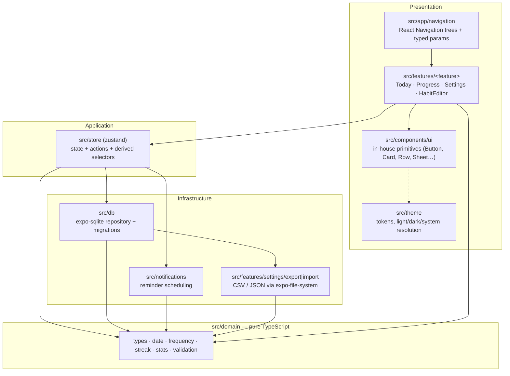

# Architecture — Ritual

**Audience:** someone opening the repo cold, or reviewing a pull request.
**Scope:** layer boundaries, the dependency rule, data flow, the date model, migrations and error handling.

> **Status note.** Every layer below exists in the tree today (`src/domain`, `src/db`, `src/store`, `src/notifications`, `src/theme`, `src/components`, `src/features`, `src/app`), together with the test suite that holds their boundaries: 132 co-located tests under `src/**/__tests__`, deterministic through injected clocks and without native modules. Screens are the deliberate gap — they are verified on a device, and everything they render is derived from the tested selectors and domain functions.

---

## 1. Layer diagram



Equivalent in text, with the arrow direction meaning "may import from":

```text
 src/app/navigation   src/features/*   src/components/ui   src/theme
          |                 |                 |
          +-----------------+-----------------+
                             |
                     src/store (zustand)
                        |         |
            +-----------+         +-----------+
            |                                 |
      src/db (expo-sqlite)             src/notifications
      + migrations, row mappers        + trigger building
            |                                 |
            +-----------------+---------------+
                              |
                       src/domain  <———— also read directly by UI
                 pure TS: types, date, frequency,
                 streak, stats, validation
        (imports nothing from React Native, React or Expo)
```

## 2. The dependency rule

**One sentence:** `src/domain` may import only from `src/domain` and from the ECMAScript/TypeScript standard library; everything else may import from anything at a lower layer, never upward.

Enforced by:

1. **Convention and review.** No file in `src/domain` imports `react`, `react-native`, `expo-*` or `@react-navigation/*`. A PR that adds such an import is a boundary violation regardless of whether it type-checks.
2. **Direct imports, small folders.** Modules import each other's files explicitly (`import { listHabits } from '../db/repositories/habitRepository'`); there is no alias or barrel indirection hiding a cross-layer jump, so a boundary violation is visible in the import line of the diff. There are no `index.ts` re-export barrels inside `src/` — the only one is the entry point at the repository root — so every import names the file it really depends on.
3. **Coverage scoping as a proxy signal.** `jest.config.js` collects coverage from the pure logic that is actually asserted on — `src/domain/**/*.ts`, `src/store/selectors.ts`, `src/db/mapping.ts`, `src/utils/id.ts` and `src/components/HabitRow.tsx` — and sets a threshold on that set. If domain code started depending on native modules, its tests would stop running under plain Jest, which is a fast and unmistakable alarm.

Practical consequences:

- Domain functions take plain data (`string` dates, `Set<string>`, `number` timestamps) and return plain data. They never read globals, never touch `Date.now()` without an injectable parameter, and never return JSX.
- Because of that, the same `computeStreak` that renders the Today screen can be run in a Node REPL, in a Jest worker, or in a future CLI/server without a port.
- UI layers may import domain _types_ and _pure functions_ freely (this is what makes the labels in the store cheap), but they may not define business rules locally. If a screen needs to know whether a habit is due today, it calls `isScheduledOn`/`isSatisfiedToday`; it does not re-implement the switch.

## 3. Data flow: one check-in tap

```text
Tap habit row (src/features/today/TodayScreen.tsx)
  └─ useRitualStore action: toggleToday(habitId)
      └─ toggleCompletionOnDay(habitId, state.today)
          ├─ src/db/repositories/completionRepository.toggleCompletion(db, habitId, localDate)
          │     ├─ isCompletedOn(...) ? uncomplete()  -> DELETE FROM completions
          │     │                                       WHERE habit_id = ? AND local_date = ?
          │     └─ otherwise complete() -> INSERT OR IGNORE INTO completions
          │                               (habit_id, local_date, completed_at, note) VALUES (?, ?, ?, ?)
          │          the UNIQUE(habit_id, local_date) index is what makes a double tap
          │          idempotent — "OR IGNORE" plus the schema, not an application check
          ├─ every statement is bound with ? placeholders; SQL text is a literal
          └─ set({ completions: { ...state.completions, [habitId]: next } })   // in-memory mirror
  └─ selectors re-derive from the snapshot (src/store/selectors.ts)
      ├─ selectTodayRows / selectRowFor  -> HabitWithProgress
      ├─ statsFor -> computeHabitStats(habit, dates, today)      -> src/domain/stats.ts
      │     ├─ computeStreak(...)                                -> src/domain/streak.ts
      │     └─ expectedCompletions(...)                           -> src/domain/frequency.ts
      └─ selectProgressSummary / selectDailyTotals for the Progress tab
  └─ the row re-renders: ring fill, streak chip label ("6 days" / "6 weeks"), heatmap column
  └─ habit-shape changes (reminder time, archive) call reloadReminders(), which runs
     syncReminders(habits) in src/notifications/reminders.ts — local daily triggers only
```

Three properties worth defending:

- **The streak number is never stored.** There is no `streak` column to keep in sync; every visible number is a pure function of the `completions` rows plus the habit's frequency and creation date. Impossible to drift, cheap to recompute at this dataset size.
- **The store mirrors, the database decides.** `useRitualStore` writes through the repository and then updates its own `completions` map with the value the repository returned, so an optimistic tap and a rejected write cannot disagree with the file on disk.
- **Idempotence by schema, not by code.** `UNIQUE (habit_id, local_date)` plus `INSERT OR IGNORE` means "tap twice" and "tap during a re-render race" both converge on one completion row.

## 4. Why the streak maths is pure and framework-free

Streaks are the one place where a habit app is usually wrong, and the reasons are structural:

1. **The unit changes with the frequency model.** `every_day` and `specific_days` count consecutive scheduled _days_; `times_per_week` counts consecutive ISO _weeks_ in which the number of completions reached the target. `computeStreak` returns `{ unit, current, longest }`, and `streakLabel` renders "6 days" or "6 weeks" accordingly. A stored integer could not express that distinction.
2. **"Consecutive" is only meaningful over scheduled periods.** For a Mon/Wed/Fri habit, a missing Tuesday is not a gap. `scheduledDays` enumerates only the days the rule asks for, and the run scan walks that list.
3. **Partial periods must not be punished.** `currentRun` takes a `gracePeriod` argument: the last element of the period list may be unsatisfied without breaking the run when it is the period the user is still inside (today, or `weekKey(today)`). The grace only applies to the newest period — an unsatisfied _older_ period still terminates the scan, so real gaps still count.
4. **Purity is what makes those rules testable at all.** Every entry point accepts an explicit `today` (`computeStreak(freq, dates, startISO, today)`, `computeHabitStats(habit, dates, today)`), so a test can assert "a 3×/week habit with two check-ins in the current week keeps its streak" without faking a clock, a native module or a database.
5. **`longest` is clamped.** `computeHabitStats` returns `Math.max(streak.longest, streak.current)` — a history-preserving invariant that stops the UI from ever showing a longest streak below the current one after an archive or a data import.

See [ADR 0004](./adr/0004-week-based-streaks-for-quota-habits.md) for the product reasoning and the trade-offs accepted.

## 5. The date model: civil dates, not instants

### Stored forms

| Concept                               | Representation                                                        | Where                                     |
| ------------------------------------- | --------------------------------------------------------------------- | ----------------------------------------- |
| A check-in's day                      | `YYYY-MM-DD` string in the **user's local calendar day**              | `completions.local_date`                  |
| Ordering/audit instant for a check-in | epoch milliseconds                                                    | `completions.completed_at`                |
| Habit creation / archiving            | epoch milliseconds                                                    | `habits.created_at`, `habits.archived_at` |
| Reminder time                         | `HH:MM` local string, or null                                         | `habits.reminder_time`                    |
| Week identity                         | ISO-8601 key `YYYY-Www` (Monday start)                                | derived, never stored                     |
| Day arithmetic                        | integer "day number" = days since 1970-01-01, computed via `Date.UTC` | derived                                   |

**Why UTC instants are avoided for the day of a completion.** A habit completion asserts a fact about the _calendar_, not about a moment: "I did it on the 12th". Encode it as an instant and two everyday events break the assertion:

- **Daylight-saving transitions.** A stored instant combined with a DST-aware formatter can move a late-evening check-in into the following day, or pull a midnight one back. The day the user meant is the day they see on screen.
- **Travel and time-zone changes.** A user who checks in on a flight, or who moves between zones, must not watch yesterday's completion re-label itself as today's (or disappear from the heatmap) because the offset changed.
- **Comparison semantics.** Consecutive-day logic becomes integer subtraction on day numbers (`diffDays`, `addDays`) rather than duration maths with 23- and 25-hour days.

Implementation notes from [`src/domain/date.ts`](../src/domain/date.ts):

- `fromISODate` rejects impossible dates by round-tripping through `Date.UTC`, so `2026-02-30` throws rather than silently becoming March 2.
- `dayNumber`/`isoFromDayNumber` do all arithmetic in UTC milliseconds-of-the-epoch, which is stable precisely because the values are treated as _day indices_, never as local instants.
- `todayISO(now = new Date())` reads local `getFullYear/getMonth/getDate` — the only place the device's zone legitimately enters the system, and it is injectable for tests.
- `startOfWeekISO(iso, weekStartsOn = 1)` keeps the week boundary a parameter, so a future "first day of week" preference is a call-site change, not a rewrite.
- `isoWeek` pins the ISO year via the week's Thursday, which is why 2027-01-01 can belong to `2026-W53`. Getting this wrong is the classic source of "my streak reset on New Year".
- Formatting helpers (`weekdayLabel`, `friendlyDateLabel`, `formatTime`) use `Intl` with `timeZone: 'UTC'` on a day-index-derived `Date`, so locale rendering never re-interprets the stored civil date.
- `clampToToday` in `src/domain/stats.ts` guards a future `createdAt` (wrong device clock) from erasing history by clamping the stats window start to today.

**One deliberate inconsistency to know about.** A `weekStartsOn` preference (0 = Sunday, 1 = Monday) is persisted in `preferences` and used by the detail screen's `WeekStrip` to decide how a week is _drawn_. The streak engine's period keys (`weekKey`, `weekKeysBetween`) use Monday-based ISO weeks regardless of that preference. Sunday-start display and Monday-start accounting therefore disagree by design for now; unifying them changes which completions fall in which streak period, so it is a behaviour change with tests, not a cosmetic one.

## 6. Persistence and migration strategy

Owned by `src/db`. Principles:

1. **The repository is the only SQLite caller.** Screens and store actions never build SQL. Row→domain mapping lives here, so a schema change touches two files (a migration and a mapper), not twelve screens.
2. **Schema version comes from SQLite `PRAGMA user_version`**, not from a table of your own invention; it is atomic with the transaction that creates it.
3. **Migrations are forward-only, numbered, and immutable once shipped.** `src/db/schema.ts` owns `DATABASE_NAME = 'ritual.db'` and `DATABASE_VERSION`; `src/db/migrations.ts` owns the append-only list of `{ version, sql }` entries.

   ```ts
   // src/db/migrations.ts — append-only; bump DATABASE_VERSION in schema.ts to match
   export type Migration = { version: number; sql: string };

   export const MIGRATIONS: Migration[] = [
     { version: 1, sql: SCHEMA_SQL }, // shipped — never edited again
     // { version: 2, sql: ADD_SOMETHING_SQL }, // new work appends here
   ];
   ```

   `runMigrations` reads `PRAGMA user_version`, refuses to open a database newer than the app understands (rather than guessing), enables `journal_mode = WAL` and `foreign_keys = ON` outside a transaction — pragmas cannot run inside one — and applies each pending migration with `withTransactionAsync`, setting `PRAGMA user_version = <version>` in the same transaction. The interpolated value there is a numeric constant taken from the migration list, never from data. `withExclusiveTransactionAsync` is not used anywhere: expo-sqlite throws `withExclusiveTransactionAsync is not supported on web`, and a single connection per app has no other writer to exclude.

4. **Never edit a shipped migration.** Add `version: N+1`. A user two releases behind must arrive at exactly the same schema as someone upgrading step by step; editing an applied migration breaks that equivalence and is the most common way to corrupt a live install. If a shipped migration was wrong, write a corrective migration and, if necessary, a repair step in the newer one.
5. **Each migration runs inside a transaction**, so a mid-migration failure leaves the previous version intact and the app refuses to open half-migrated data.
6. **SQLite DDL only via statements the module can execute statically.** Multi-statement DDL uses `execAsync` with literal SQL; anything with user input uses `runAsync` with `?` placeholders (see the injection row in [SECURITY.md](../SECURITY.md)).
7. **Column additions are nullable or defaulted.** No rewrite of user history for a cosmetic field.
8. **No destructive migration in a released app.** `onUpgrade` never drops a table that holds user data; "archive" is a soft delete (`archived_at`), so history keeps feeding stats and a restore stays possible.
9. **Export/import is the migration escape hatch.** A JSON dump is versioned alongside the schema, so a future breaking schema change can read old exports.
10. **Integrity constraints in SQL, not only in TypeScript**: `UNIQUE(habit_id, local_date)` on completions, `ON DELETE CASCADE` for a hard delete of a habit and its history, `CHECK` constraints on the `HH:MM` pattern where practical.
11. **Prebuild-safe.** `android/` and `ios/` are generated ([`.gitignore`](../.gitignore) excludes them); native schema behaviour is configured by the `expo-sqlite` config plugin and never hand-edited.

## 7. Error-handling policy

| Layer                | Failure                                                        | Policy                                                                                                                                                                                                                                          |
| -------------------- | -------------------------------------------------------------- | ----------------------------------------------------------------------------------------------------------------------------------------------------------------------------------------------------------------------------------------------- |
| `src/domain`         | Impossible date, malformed `HH:MM`, out-of-range weekly target | **Throw `RangeError`** for invalid date strings (a programming error, caught by validation before it reaches here); **return `null`/`{ ok: false, errors }`** for user input (`parseTime`, `validateHabit`). Never guess a correction silently. |
| `src/domain` (stats) | Out-of-window or future data                                   | **Clamp and continue** (`clampToToday`, filters `iso <= today`), so a wrong clock degrades the display rather than emptying it.                                                                                                                 |
| `src/db`             | Migration failure                                              | **Fail closed**: log with `console.error`, surface a non-dismissible error screen, do not silently rebuild the database (that would delete user data).                                                                                          |
| `src/db`             | Constraint violation on a double tap                           | **Treated as success** — the row already exists; return the existing completion and keep the UI idempotent.                                                                                                                                     |
| `src/db`             | Disk full / write rejection                                    | **Revert the in-memory mirror so it matches the row on disk**, and surface an inline error on the affected row rather than the whole screen; the rest of the app stays usable.                                                                  |
| `src/store`          | Selector called before hydration                               | Return an explicit loading/empty state; never fabricate a zero streak that the user reads as "lost".                                                                                                                                            |
| `src/notifications`  | Permission denied                                              | Degrade quietly: reminders stay off with a visible "enable" path in the editor and Settings (which also has a "send a test reminder" action). No modal nagging, no retry loop.                                                                  |
| `src/notifications`  | `expo-notifications` unavailable (Expo Go)                     | Detect via the runtime check and state in the UI that reminders need a development build; never crash.                                                                                                                                          |
| `src/app`            | Cold start failure (open, migration, seed, hydrate)            | `AppProviders` owns the boot sequence; a throw from migration or hydration must reach `src/app/ErrorBoundary.tsx` and be shown, not swallowed.                                                                                                  |
| UI                   | Any unexpected error                                           | `src/app/ErrorBoundary.tsx` renders a friendly screen with a retry/restart action; there is no remote reporting to send it to, by design.                                                                                                       |

House rules: no empty `catch {}`; no `console.log` in app code (ESLint enforces `no-console` with `warn`/`error` allowed); `try/catch` sits at the boundary where the error becomes a user-visible decision, not around every call.

## 8. State management

`zustand` is the store, chosen over a reducer-per-feature approach because the app's state is a small cache of rows plus a handful of UI flags:

- **Store holds entities, selectors hold derivations.** The store contains `habits` and a `completions` map of habit id → local dates, exactly as fetched from the repository. Streaks, consistency, heatmap cells and weekday rates come from `src/store/selectors.ts`, which calls domain code (`selectTodayRows`, `selectRowFor`, `selectProgressSummary`, `selectDailyTotals`, `statsFor`). Nothing derived is stored.
- **One store** — `useRitualStore` in `src/store/useRitualStore.ts` — with actions named as verbs: `bootstrap`, `refresh`, `createHabit`, `saveHabit`, `toggleToday`, `toggleCompletionOnDay`, `setReminderTime`, `archive`, `unarchive`, `destroy`, `setTheme`, `setWeekStartsOn`, `reset`. Screens pull an action by reference (`const toggleToday = useRitualStore((s) => s.toggleToday)`) rather than reading state they do not render.
- **Persistence is the database, not the store.** No middleware writes state to disk. Boot order is `src/app/providers/AppProviders.tsx`: open `ritual.db` → `runMigrations` → `seedOnFirstRun` → hydrate from `listHabits` + `listAllCompletionDates`. That keeps one authoritative copy and one obvious place where a cold start can fail.
- **No fabricated history on first run.** `seedOnFirstRun` creates three starter habits and **zero** check-ins, so nobody opens the app to a streak they did not earn; the flag is `hasCompletedOnboarding` / `markOnboardingComplete` in the preferences table.
- **Subscription granularity matters on mobile.** `useSnapshot()` gives a screen the narrow view it renders, and actions mutate a single habit's date list rather than replacing the whole map, so one tap does not re-render every row.
- **Theme is applied at the shell** (`src/theme/theme.ts` exposes `buildTheme`/`useTheme`, and `userInterfaceStyle: "automatic"` follows the system), so light/dark/system never touches feature code.

## 9. Navigation

- **Bottom tabs:** Today / Progress / Settings (`@react-navigation/bottom-tabs`).
- **Native stack over the tabs** (`@react-navigation/native-stack`): `HabitEditor` for create and edit (`{ habitId?: string }` — absent means create), and `HabitDetail` for one habit's history with its week strip (`{ habitId: string }`). The tabs themselves sit in the stack as `Tabs`.
- **One typed contract in `src/app/navigation/types.ts`:** `TabsParamList` and `RootStackParamList`, with `RootStackScreenProps`/`TabsScreenProps` composites and a `declare global { namespace ReactNavigation { interface RootParamList … } }` augmentation so plain `useNavigation()` is already typed. Untyped `navigate('string')` calls are a review comment.
- **Why not Expo Router here:** see [ADR 0003](./adr/0003-react-navigation-over-expo-router.md).

## 10. What lives where

```text
ritual/
├── App.tsx                     # shell: providers, theme, navigation container
├── index.ts                    # registerRootComponent entry
├── app.json                    # Expo config: ids, plugins, scheme, iOS plist keys
├── eas.json                    # development / preview / production build + submit profiles
├── package.json                # scripts and the authoritative dependency list
├── jest.config.js              # jest-expo preset, coverage scope + threshold
├── jest.setup.ts               # mocks for expo-notifications / expo-device
├── eslint.config.js            # flat config from eslint-config-expo
├── tsconfig.json               # strict + noUncheckedIndexedAccess
├── legal/                      # privacy, terms, data-safety mapping, store checklist
├── docs/                       # this file, ADRs, release process, screenshot manifest
└── src/
    ├── domain/                 # PURE TS — no React, React Native or Expo imports
    │   ├── types.ts            # Habit, Completion, Frequency union, HabitStats, limits, tokens
    │   ├── date.ts             # civil-date helpers, day numbers, ISO week keys, time parsing
    │   ├── frequency.ts        # isScheduledOn, scheduledDays, expectedCompletions, weekKeysBetween
    │   ├── streak.ts           # computeStreak (day|week units), grace rule, isSatisfiedToday
    │   ├── stats.ts            # computeHabitStats, buildHeatmap, weekdayBreakdown, percentage
    │   ├── validation.ts       # validateHabit, validateFrequency, duplicateNameCheck
    │   ├── backup.ts           # BackupFile schema ('ritual.backup' v1), parseBackup, CSV writer
    │   └── __tests__/          # date, frequency, streak, stats, validation, backup, types
    ├── db/
    │   ├── schema.ts           # DATABASE_NAME 'ritual.db', DATABASE_VERSION, static SCHEMA_SQL DDL
    │   ├── migrations.ts       # append-only MIGRATIONS, PRAGMA user_version, transactional apply
    │   ├── mapping.ts          # row <-> domain mapping, frequency (de)serialisation
    │   ├── types.ts            # row shapes
    │   ├── seed.ts             # seedOnFirstRun: three starter habits, no fabricated check-ins
    │   ├── backup.ts           # collectBackup/collectCsv, writeExportFile, exportJsonFile/CsvFile,
    │   │                       # previewExport, applyBackup (merge | replace)
    │   ├── repositories/
    │   │   ├── habitRepository.ts      # list/get/insert/update/archive/unarchive/delete/reorder
    │   │   ├── completionRepository.ts # list/toggle/complete/uncomplete/setNote/counts
    │   │   └── preferenceRepository.ts # theme, weekStartsOn, onboarding flag
    │   └── __tests__/          # mapping.test.ts — row <-> domain round trips
    ├── store/
    │   ├── useRitualStore.ts   # zustand store: bootstrap + actions (createHabit, saveHabit,
    │   │                       # toggleToday, toggleCompletionOnDay, setReminderTime, archive,
    │   │                       # unarchive, destroy, setTheme, setWeekStartsOn, refresh, reset)
    │   ├── useSnapshot.ts      # hook that subscribes a screen to the narrow slice it renders
    │   ├── selectors.ts        # selectTodayRows, selectRowFor, selectProgressSummary,
    │   │                       # selectDailyTotals, statsFor  (all delegate to src/domain)
    │   └── __tests__/          # selectors.test.ts — derived numbers, nothing stored
    ├── notifications/
    │   └── reminders.ts        # handler install, Android channel 'ritual.reminders', permission
    │                           # request, buildDailyTrigger, syncReminders, sendTestReminder
    ├── theme/
    │   ├── palette.ts          # light/dark colour tokens (and the habit colour tokens)
    │   └── theme.ts            # spacing/radius/typography/touchTarget, buildTheme, useTheme
    ├── components/             # composite, app-aware widgets
    │   ├── HabitRow.tsx  Heatmap.tsx  MiniBars.tsx  WeekStrip.tsx
    │   ├── __tests__/          # HabitRow.test.tsx — render + press behaviour
    │   └── ui/                 # framework-neutral primitives
    │       └── Button.tsx Card.tsx EmptyState.tsx Fab.tsx ProgressBar.tsx Screen.tsx
    │                           StepperButton.tsx Text.tsx
    ├── features/
    │   ├── today/              # TodayScreen: one-tap check-in, streak chips, FAB
    │   ├── progress/           # ProgressScreen: consistency, heatmap, weekday breakdown
    │   ├── detail/             # HabitDetailScreen: per-habit history with a week strip
    │   ├── settings/           # SettingsScreen: theme, week start, permissions, test reminder,
    │   │                       # export JSON/CSV, import merge|replace
    │   └── editor/             # HabitEditorScreen, FrequencyPicker, TimeField, pickers
    ├── app/
    │   ├── providers/          # AppProviders: open db -> runMigrations -> seedOnFirstRun -> hydrate
    │   ├── navigation/         # types.ts (TabsParamList, RootStackParamList), RootNavigator.tsx
    │   └── ErrorBoundary.tsx   # last-resort friendly error UI (no remote reporting)
    └── utils/
        ├── id.ts               # createId() — local identifier generation
        └── __tests__/          # id.test.ts
```

## 11. Deliberate omissions

| Not present                               | Why                                                                                                                                                                                                                              |
| ----------------------------------------- | -------------------------------------------------------------------------------------------------------------------------------------------------------------------------------------------------------------------------------- |
| Any server, sync or realtime layer        | [ADR 0001](./adr/0001-offline-first-no-backend.md). Offline-only is the product stance, not a phase.                                                                                                                             |
| Analytics, feature flags, crash reporting | Would require a network permission the app does not have.                                                                                                                                                                        |
| A generic repository/service framework    | Three aggregate roots (habits, completions, preferences) do not earn abstraction; the repository is a hand-written module.                                                                                                       |
| State persistence middleware              | SQLite already persists; duplicating state into key-value storage creates two sources of truth.                                                                                                                                  |
| `android/` / `ios/` in git                | Continuous Native Generation: [`npm run prebuild`](../package.json) regenerates them from `app.json` + plugins.                                                                                                                  |
| Third-party chart library                 | The heatmap (`src/components/Heatmap.tsx`) and the small bar/week-strip views (`MiniBars.tsx`, `WeekStrip.tsx`) are simple enough to own in-house, and it keeps the dependency surface small — no SVG or charting native module. |

## 12. Reading order for a reviewer

1. [`src/domain/types.ts`](../src/domain/types.ts) — the vocabulary.
2. [`src/domain/date.ts`](../src/domain/date.ts) then [`src/domain/frequency.ts`](../src/domain/frequency.ts) — the two invariants everything else rests on.
3. [`src/domain/streak.ts`](../src/domain/streak.ts) — where the interesting product decisions live, and the first file to write tests for.
4. [`src/domain/stats.ts`](../src/domain/stats.ts) — how derived numbers are produced, and why none are stored.
5. [`src/db/schema.ts`](../src/db/schema.ts) and [`src/db/migrations.ts`](../src/db/migrations.ts) — the constraints the app actually relies on, and the append-only version ladder around them.
6. [`src/app/providers/AppProviders.tsx`](../src/app/providers/AppProviders.tsx) then [`src/store/useRitualStore.ts`](../src/store/useRitualStore.ts) — the cold-start sequence and the only place writes happen.
7. [`jest.config.js`](../jest.config.js) — the coverage boundary, which is a statement about where correctness will be claimed.
8. [`app.json`](../app.json) — the native surface the app actually asks for.

---

Related: [ADR index](./adr) · [README](../README.md) · [SECURITY.md threat model](../SECURITY.md) · [CONTRIBUTING.md](../CONTRIBUTING.md)
